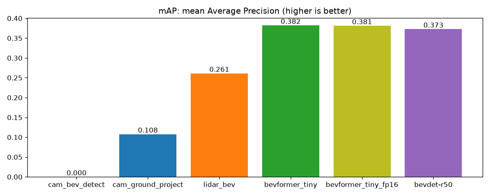
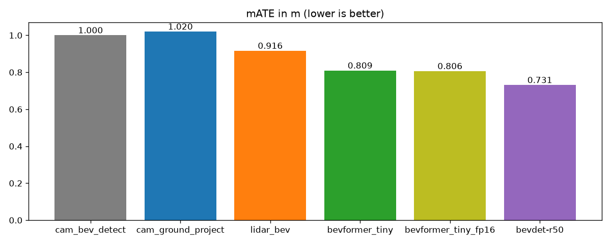
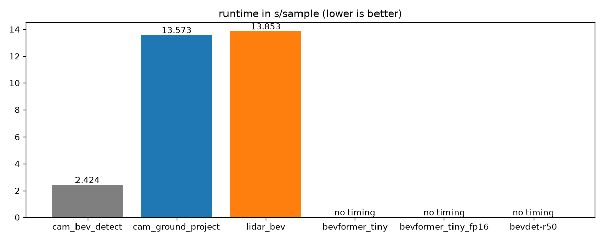

# Project 3: BEVFormer + nuScenes

## Running the eval benchmark

`eval_benchmark.py` scores every method's saved `outputs/<method>/results.json` and prints mAP, mATE and runtime. It does not run the methods, so run each method's script first (`outputs/` is git-ignored, so results are not shared through git).

```bash
cd DeterministicBev                    # the project folder
source .venv/bin/activate              # or `source activate.sh` on the BEVFormer machine

# 1. produce results (only needed when a method changes)
python deterministic_bev_cam.py        # stitched BEV baseline  -> outputs/cam_bev_detect/
python cam_ground_project.py           # ground projection      -> outputs/cam_ground_project/
python deterministic_bev_lidar.py      # camera + LiDAR         -> outputs/lidar_bev/

# 2. score everything
python eval_benchmark.py
```

Expected output, one line per method:

```
[ground_truth] mAP 1.0000 | mATE 0.000 m | no timing        <- sanity check
[cam_bev_detect] mAP ... | mATE ... m | ... s total, ... s/sample (cpu)
```

# Robot Localization
Author: Jack, Isa

For Olin ENGR3590 Computational Introduction to Robotics

This README is a comprehensive report that contains both conceptual and programmatic information regarding implementation details of our machine vision project.

## 1. Project Overview

The goal of this project is to learn the vision perception layers of modern autonomous vehicles (AV) by examining industrial practices and implementing our own algorithms. With a growing popularity of autonomous vehiclces companies like Waymo, Zoox, Tesla, etc., we want to gain a comprehensive understanding of what and why certain sensors and techinques are used, as well as the performance of different methods. This write up will present the implementation, results, and learning from comparing 6 different approaches we used, and a comparison analysis using the benchmark we picked.

## 2. Dataset and setup

To keep the project reasonably scoped, we decided to use an existing dataset instead of collecting data ourselves. This way, we also have well-processed truth to reference to when benchmarking at the end.

In terms of the database choice, we picked nuScenes, a driving dataset recorded in Boston and Singapore. We specifically use `v1.0-mini` dataset, consisting of 10 scenes (404 samples) out of the full 1,000. It is small enough to run the deterministic methods on a laptop CPU. Each scene is a 20-second drive with 3D boxes annotated on keyframes ("samples"). We chose it for the following reasons:

- **Full 360° multi-angle camera:** There are six cameras covering every direction around the car, which is a common practice on autonomous vehicles as well as what a bird's-eye view needs.
- **Multi-source sensor data:** Sensor data from camera, LiDAR and radar are all provided on the same frames. All sensors are recorded together, with calibration already and the car's position for every frame. This lets us compare sensor setups (camera only vs camera + LiDAR) on exactly the same scenes.
- **Compatibility with pretrained models:** BEVFormer and BEVDet publish checkpoints trained on nuScenes, so we can evaluate the learned methods without training them ourselves.

To run any of the processing scripts, the dataset `v1.0-mini` needs to be downloaded first from the official NuScenes website.

## 3. Methods

To maximize our learning on the topic of modern BEV processing, we decided to explore both learned models and deterministic methods in their performance in identifying and localizing objects. In this section, we present a total of six different methods we explored using the dataset. Three are learned, publicly available models found online, whereas the other three are deterministic process created by us.

### 3.1 Camera-only Stitched BEV (baseline) (`deterministic_bev_cam.py`)

In the dataset, there are multiple sources of information from sensors like cameras, LiDARs, radars, etc. In the first method, we decided to explore how good a BEV we can construct if we rely only on the cameras as input. Then, while designing the processing pipeline, we realized we have options about where to introduce the detection step: whether we construct the BEV first or detect objects first. In this first method, we explore how the algorithm performs using only the cameras and constructing the BEV first.

The most direct way to get a BEV from cameras is to warp the camera images themselves onto the ground and look at them from above. We decided to take this intuitive approach that is also called inverse perspective mapping (IPM). It works by warping raw camera images and stitching them together based on each camera's orientation relative to the car. The algorithm functions by constructing the empty BEV top-down map first, and then looking up, in reverse, which camera pixel captures each spot in real-world coordinates. The color is then simply copied.

As shown in image below, the farther the pixels are from the car, the more distorted they are because of the lack of information on depth for each pixel. Even though closer objects take up more pixels in the raw image, the constructor does not know the actual depth of each pixel, which is why they all end up uniformly stretched as if they were just air.

After we have the BEV image, we ran the COCO-pretrained Faster R-CNN detector as our detector model in this project. It is a reliable model that covers enough object classes found on roads. As seen in the image, the result is not ideal. Barely any vehicles or objects are detected.

Even though the image is distorted, we still plan to use this as our baseline to gain insights on why other methods outperform this approach.


*Stitched BEV for one sample of scene-0103. Green circles are ground-truth object centers; red is the detector's only box.*


### 3.2 Camera-only Ground Projection (`cam_ground_project.py`)

The baseline showed that warping the whole image onto the ground destroys the objects we want to find, because anything with height gets smeared. Therefore, in the second method, we will swap the order: We detect objects first in the raw image footage, and only then build the BEV. Instead of warping every pixel onto the ground, we only put detected objects onto the ground.

To keep the vision detection model consistent for better comparison, we run the same COCO-pretrained Faster R-CNN on each of the 6 raw camera images. Since these are normal, front-facing photos, it finds far more vehicles and pedestrians than it did on the stitched BEV. 

For every detected box, we take the pixel at the bottom-center of the box, which is roughly where the object touches the road (the wheels of a car or the feet of a person). To turn that pixel into a position on the ground, we shoot a ray from the camera through the pixel. Using the camera's calibration, the ray is a direction in the car's frame, but it does not tell us how far away the object is. To get the distance, we make the assumption that the road is flat and at the same height as our car's wheels. Since the camera's height above the road is known, we can compute where the ray hits the road. The more steeply the ray points down, the closer the object is. That point is where the object touches the ground. 

Since nuScenes scores the center of an object, not its edge, we then push the point a little farther along the ray, by about half of the object's average size, to get the center.

Like the baseline, the detector only gives a 2D box, so each object gets its class's average size from the mini_train split and a heading of 0. Because neighbouring cameras overlap, the same car can be detected multiple times. We merge these by keeping only the higher-scoring box when two boxes of the same class are within certain tolerance of each other.


*The 6 camera images for the busiest mini_val sample. Green boxes are detections labelled with the estimated distance from the car; red dots are the bottom-center pixels projected to the ground.*


*The same sample from above. Gray lines are the camera rays, red dots are where they hit the road, blue boxes are our predictions and green boxes are the ground truth.*

As seen in the images, this approach works well for nearby objects. Although no realistic BEV images are shown anymore, locations of detected objects like pedestrians and cars are all shown on the BEV projected image. However, everything depends on the flat-ground assumption, and the method has no way to check how far the object really is, or handle cases where the ground is not flat.

This shows the core limitation of using a camera alone. A single image has no depth, so the method has to assume something about the world to get a distance, and it cannot tell when that assumption is wrong.

### 3.3 Camera rays + LiDAR
The LiDAR model begins by capturing each frame from every camera view. Through each perspective, the COCO-pretrained Faster R-CNN model is run, resulting in bounding boxes for every detected object. These bounding boxes can then be converted from UV coordinates in the camera image space to a pointing vector relative to the camera (this is done using the mapping methods provided by the nuscenes python library).

We plumb these pointing vectors into a point cloud collected from the past 10 samples of lidar data. This collection and amalgamation function is also provided by the nuScenes dataset and automatically maps the LiDAR points to the active camera's frame. For each ray, we compare its heading with the LiDAR points' headings. We select the LiDAR points most aligned with our ray's heading and return that point's depth to the camera. A good example of our unit testing is in the first two lines of this process, where we check that our points list is not irregular.
```
points = points[np.isfinite(points).all(axis=1)]
points = points[np.linalg.norm(points, axis=1) > 1e-6]
```
Once depths are obtained, we map these camera-relative depths and direction vectors to the world-coordinate points of our detected objects. We then draw bounding boxes based on the average bounds in the nuScenes training data, and expose the resulting bounding boxes for evaluation.
#### Limitations
This model has no way to approximate each object's heading, which results in high error. Additionally, without temporal attention, information gained over time, such as object velocity, is lost. Finally, when tracking objects, the model can recognize an object multiple times across different perspectives, which could result in multiple independent bounding boxes being placed on top of eachother.

### 3.4 BEVFormer tiny (FP32)
BEVFormer Tiny is a transformer-based model that extracts features from multi-view camera inputs and projects them into a 3D BEV grid containing semantic information (effectively acting as a voxel representation of the world around the vehicle). BEVFormer utilizes Spatial Cross-Attention (SCA) to query and fuse features seamlessly across varying camera perspectives, and Temporal Self-Attention (TSA) to track scene movement across historical frames.
#### Limitations
 - Due to BEVFormer's transformer nature, the model is very heavy and compute-intensive. It is very difficult to run this model on any lightweight hardware
 - Because BEVFormer is so reliant on depth estimation across cameras, it relies heavily on accurately calibrated camera feeds. Pixel-level misalignment can drastically damage a model's accuracy and ability to estimate depth.
 - Due to BEVFormer's camera-exclusive nature, its depth estimation can be unreliable, especially as an object gets farther away.

### 3.5 BEVFormer tiny (FP16)
BEVFormer Tiny FP16 is the same model as BEVFormer Tiny FP32, but uses 16-bit floating-point numbers for its model weight storage. This rougly halves the storage needed to unpack the model, and can significantly speed up inference on machines with tensor cores.

#### Limitations
 - Reduced numeric accuracy can result in model breakdown or performance loss.

### 3.6 BEVDet R50
BEVDepth R50 approaches depth differently than BEVFormer; BEVDepth processes each image individually by passing it through ResNet50 to extract detailed features. BEVDepth then uses a second network head to iterate through every pixel of the image and estimate a metric depth from the camera. Once this depth map is generated, the model projects each pixel onto a point cloud. These points are compressed into a 2D field using a method known as splatting, and a detection head runs on the resulting field to separate and label objects.

Notably, BEVDepth R50 uses LiDAR data through training to build its depth estimation network, but during inference it needs no LiDAR ground truth.
#### Limitations
 - BEVDepth relies on accurate initial estimation of depth, so the model accuracy really depends on how robust the depth netork head's training regime was.
 - BEVDepth is especially sensitive to visual noise & disruption. Heavy rain or sensor washout from reflected sun can cripple perception
 - The splatting step for 2D compression prevents the need of complex 3D attention heads and object detectors, but requires a compute-intensive compression algorithm which can take longer to execute than traditional 3D detection.
## 4. Evaluation Metrics

To compare all six methods fairly, we score them with the official nuScenes detection evaluator on the same 81 samples. For every method script, we report three metrics:

- **mAP (mean Average Precision):** how well the method detects the right class. It counts a hit if the center is within certain tolerance of a real object. The higher the better.
- **mATE (mean Average Translation Error):** for the objects found, how far off the center is, in metres. Lower is better.
- **Runtime:** seconds per sample to run the whole script (CPU for the deterministic methods, GPU for the learned models).

We only score the 6 classes that our COCO detector can produce: car, truck, bus, pedestrian, bicycle and motorcycle. We also only report mAP and mATE out of the evaluator's metrics, because those depend only on an object's class, ground position and score, which every method actually predicts. 

These benchmarks are stored in the evaluation script (`eval_benchmark.py`). The benchmark does not run the methods itself. Each method's script saves its predictions to `outputs/<method>/results.json` in the nuScenes results format. Each script also saves a `timing.json` with its runtime wherever applicable.

## 5. Results and Discussion

**Detection (mAP).** As shown in the image below, the stitched BEV baseline scores 0 on mAP. The detector finds almost nothing in the smeared top-down image, which confirms that warping whole images onto the ground destroys the objects we want to find. The second method, which is detecting first and projecting, raises mAP to 0.108, even though it uses the exact same detector. This directly shows that the order of the steps matters more than the model. Finally, replacing the flat-ground guess with a measured LiDAR distance in method 3 more than doubles mAP again to 0.261. 

The three learned models score highest, around 0.37 to 0.38, using cameras only. The FP16 version of BEVFormer loses almost no accuracy compared to FP32 (0.381 vs 0.382).



**Position error (mATE).** The baseline's 1.000 is not a real error. It matched no objects, so nuScenes reports 1.0 as a placeholder. For method 2, ground projection is off by about 1 m on average, mostly from far objects whose distance blows up near the horizon. In method 3, LiDAR improves this to 0.92 m. It is very accurate for thin objects like pedestrians, but for cars, trucks and buses the LiDAR point lands on the side of the object facing us rather than its center, which leaves an error of more than 1 m. 

The learned models place objects best, with BEVDet the most precise at 0.73 m.



**Runtime.** Among our deterministic methods, the baseline is the fastest (2.4 s per sample) because it runs the detector once on the stitched image, while ground projection and LiDAR run it six times, once per camera (about 13.6 to 13.9 s per sample). Adding LiDAR costs almost no extra time over ground projection, so its accuracy gain comes nearly for free. These three deterministic methods are run on CPUs.

On the other hand, the learned models run in 0.3 to 0.4 s per sample, but on a GPU, so most of that gap comes from the hardware rather than the method. FP16 is about 20% faster than FP32 with almost no loss in accuracy.



**Conclusion.** The results follow how each method gets an object's distance. The baseline has no distance at all and fails, ground projection guesses it from a flat-ground assumption, LiDAR measures it, and the learned models learn depth cues from a large amount of driving data. 

With a camera alone, a hand-built pipeline has to assume something about the world to recover depth, and it cannot tell when that assumption is wrong. Adding a depth sensor like LiDAR closes much of that gap cheaply, but the learned models still do best on both detection and position, even without LiDAR, while also predicting size, heading and velocity, which our deterministic methods do not estimate.

## 6. Limitations

There are a number of limitations to the results from this project. 

First of all, our evaluation set is small. We score on only 81 samples from 2 scenes, so a few good or bad frames can move the scores noticeably, and small differences, such as between BEVFormer FP32 and FP16, should not be over-read.

Our deterministic methods also only estimate where an object is and what it is. They do not predict its real size, heading or speed, and instead fill these in with the class average size, a heading of 0 and zero velocity. This is why we only compare mAP and mATE, and it means the learned models can do more than our scores show. More detailed comparisons and analysis often require more than just a single source of camera as the input.

The runtimes are not directly comparable either. Our methods ran on a laptop CPU while the learned models ran on a GPU, so most of the speed gap comes from the hardware rather than the methods themselves. For the purpose of this project, CPU was used to run some of the methods due to simplicity. However in practical use, for best performance and fast reaction time on the road, advanced computing techniques like GPU should be used.

Finally, all three deterministic methods rely on a generic detector. Faster R-CNN was trained on everyday photos (COCO), not driving data, and only covers 6 of the nuScenes classes. We decided to use this single model for controlled comparison reasons. Our methods also treat each sample on its own and do not track objects from frame to frame, which could help with hidden objects and with estimating speed.

## Contributions

The work was split equally between the two authors of this work. AI is used partially only for the purpose of formatting on the program, documentations, research of models and datasets. 
