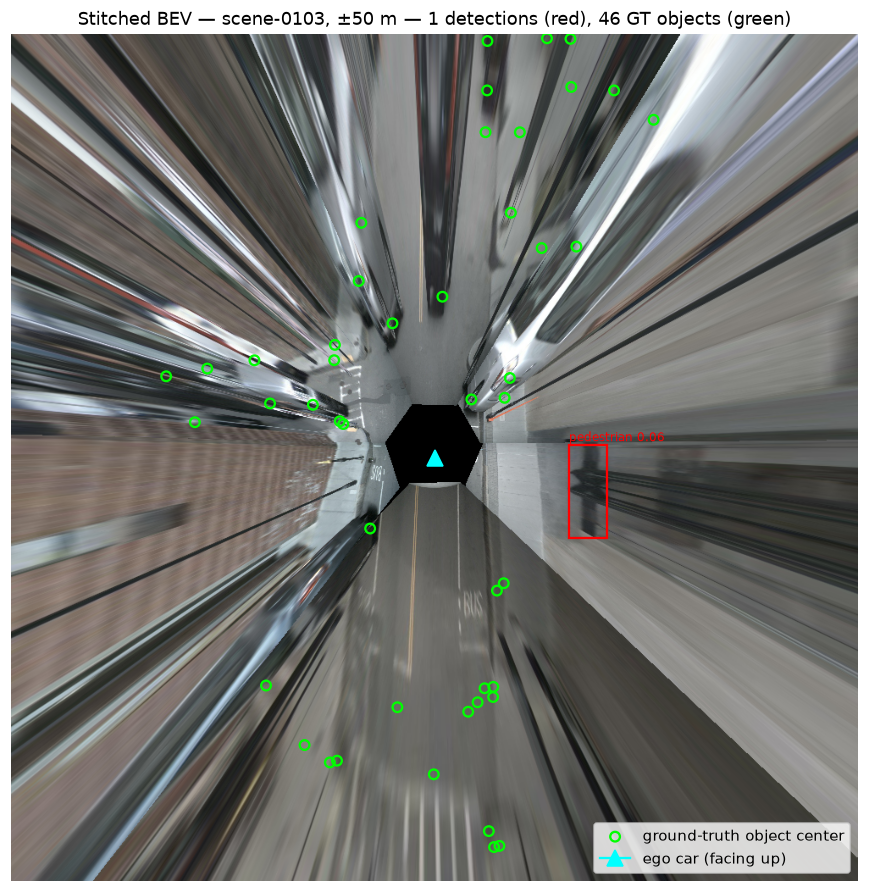
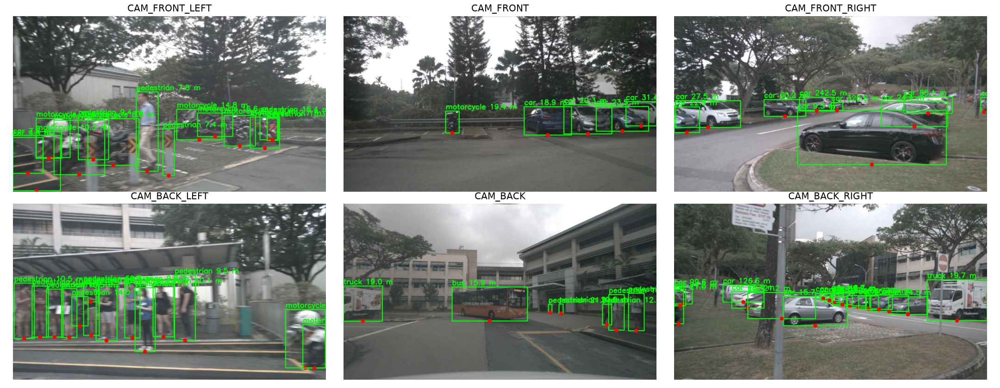
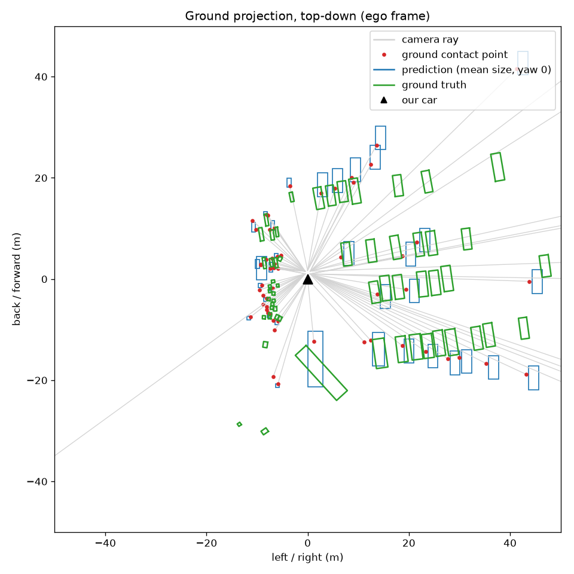

# Project 3: BEVFormer + nuScenes

## Running the eval benchmark

`eval_benchmark.py` scores every method's saved `outputs/<method>/results.json` and prints mAP, mATE and runtime. It does not run the methods, so run each method's script first (`outputs/` is git-ignored, so results are not shared through git).

```bash
cd DeterministicBev                    # the project folder
source .venv/bin/activate              # or `source activate.sh` on the BEVFormer machine

# 1. produce results (only needed when a method changes)
python deterministic_bev_cam.py        # stitched BEV baseline  -> outputs/cam_bev_detect/
python cam_ground_project.py           # ground projection      -> outputs/cam_ground_project/
python deterministic_bev_lidar.py      # camera + LiDAR         -> outputs/lidar_bev/

# 2. score everything
python eval_benchmark.py
```

Expected output, one line per method:

```
[ground_truth] mAP 1.0000 | mATE 0.000 m | no timing        <- sanity check
[cam_bev_detect] mAP ... | mATE ... m | ... s total, ... s/sample (cpu)
```

# Robot Localization
Author: Jack, Isa

For Olin ENGR3590 Computational Introduction to Robotics

This README is a comprehensive report that contains both conceptual and programmatic information regarding implementation details of our machine vision project.

## 1. Project Overview

The goal of this project is to learn the vision perception layers of modern autonomous vehicles (AV) by examining industrial practices and implementing our own algorithms. With a growing popularity of autonomous vehiclces companies like Waymo, Zoox, Tesla, etc., we want to gain a comprehensive understanding of what and why certain sensors and techinques are used, as well as the performance of different methods. This write up will present the implementation, results, and learning from comparing 6 different approaches we used, and a comparison analysis using the benchmark we picked.

## 2. Dataset and setup

To keep the project reasonably scoped, we decided to use an existing dataset instead of collecting data ourselves. This way, we also have well-processed truth to reference to when benchmarking at the end.

In terms of the database choice, we picked nuScenes, a driving dataset recorded in Boston and Singapore. We specifically use `v1.0-mini` dataset, consisting of 10 scenes (404 samples) out of the full 1,000. It is small enough to run the deterministic methods on a laptop CPU. Each scene is a 20-second drive with 3D boxes annotated on keyframes ("samples"). We chose it for the following reasons:

- **Full 360° multi-angle camera:** There are six cameras covering every direction around the car, which is a common practice on autonomous vehicles as well as what a bird's-eye view needs.
- **Multi-source sensor data:** Sensor data from camera, LiDAR and radar are all provided on the same frames. All sensors are recorded together, with calibration already and the car's position for every frame. This lets us compare sensor setups (camera only vs camera + LiDAR) on exactly the same scenes.
- **Compatibility with pretrained models:** BEVFormer and BEVDet publish checkpoints trained on nuScenes, so we can evaluate the learned methods without training them ourselves.

To run any of the processing scripts, the dataset `v1.0-mini` needs to be downloaded first from the official NuScenes website.

## 3. Methods

To maximize our learning on the topic of modern BEV processing, we decided to explore both learned models and deterministic methods in their performance in identifying and localizing objects. In this section, we present a total of six different methods we explored using the dataset. Three are learned, publicly available models found online, whereas the other three are deterministic process created by us.

### 3.1 Camera-only Stitched BEV (baseline) (`deterministic_bev_cam.py`)

In the dataset, there are multiple sources of information from sensors like cameras, LiDARs, radars, etc. In the first method, we decided to explore how good a BEV we can construct if we rely only on the cameras as input. Then, while designing the processing pipeline, we realized we have options about where to introduce the detection step: whether we construct the BEV first or detect objects first. In this first method, we explore how the algorithm performs using only the cameras and constructing the BEV first.

The most direct way to get a BEV from cameras is to warp the camera images themselves onto the ground and look at them from above. We decided to take this intuitive approach that is also called inverse perspective mapping (IPM). It works by warping raw camera images and stitching them together based on each camera's orientation relative to the car. The algorithm functions by constructing the empty BEV top-down map first, and then looking up, in reverse, which camera pixel captures each spot in real-world coordinates. The color is then simply copied.

As shown in image below, the farther the pixels are from the car, the more distorted they are because of the lack of information on depth for each pixel. Even though closer objects take up more pixels in the raw image, the constructor does not know the actual depth of each pixel, which is why they all end up uniformly stretched as if they were just air.

After we have the BEV image, we ran the COCO-pretrained Faster R-CNN detector as our detector model in this project. It is a reliable model that covers enough object classes found on roads. As seen in the image, the result is not ideal. Barely any vehicles or objects are detected.

Even though the image is distorted, we still plan to use this as our baseline to gain insights on why other methods outperform this approach.


*Stitched BEV for one sample of scene-0103. Green circles are ground-truth object centers; red is the detector's only box.*


### 3.2 Camera-only Ground Projection (`cam_ground_project.py`)

The baseline showed that warping the whole image onto the ground destroys the objects we want to find, because anything with height gets smeared. Therefore, in the second method, we will swap the order: We detect objects first in the raw image footage, and only then build the BEV. Instead of warping every pixel onto the ground, we only put detected objects onto the ground.

To keep the vision detection model consistent for better comparison, we run the same COCO-pretrained Faster R-CNN on each of the 6 raw camera images. Since these are normal, front-facing photos, it finds far more vehicles and pedestrians than it did on the stitched BEV. 

For every detected box, we take the pixel at the bottom-center of the box, which is roughly where the object touches the road (the wheels of a car or the feet of a person). To turn that pixel into a position on the ground, we shoot a ray from the camera through the pixel. Using the camera's calibration, the ray is a direction in the car's frame, but it does not tell us how far away the object is. To get the distance, we make the assumption that the road is flat and at the same height as our car's wheels. Since the camera's height above the road is known, we can compute where the ray hits the road. The more steeply the ray points down, the closer the object is. That point is where the object touches the ground. 

Since nuScenes scores the center of an object, not its edge, we then push the point a little farther along the ray, by about half of the object's average size, to get the center.

Like the baseline, the detector only gives a 2D box, so each object gets its class's average size from the mini_train split and a heading of 0. Because neighbouring cameras overlap, the same car can be detected multiple times. We merge these by keeping only the higher-scoring box when two boxes of the same class are within certain tolerance of each other.


*The 6 camera images for the busiest mini_val sample. Green boxes are detections labelled with the estimated distance from the car; red dots are the bottom-center pixels projected to the ground.*


*The same sample from above. Gray lines are the camera rays, red dots are where they hit the road, blue boxes are our predictions and green boxes are the ground truth.*

As seen in the images, this approach works well for nearby objects. Although no realistic BEV images are shown anymore, locations of detected objects like pedestrians and cars are all shown on the BEV projected image. However, everything depends on the flat-ground assumption, and the method has no way to check how far the object really is, or handle cases where the ground is not flat.

This shows the core limitation of using a camera alone. A single image has no depth, so the method has to assume something about the world to get a distance, and it cannot tell when that assumption is wrong.

### 3.3 Camera rays + LiDAR
- Idea: _placeholder_
- Pipeline: _placeholder_
- Assumptions / limitations: _placeholder_
- Figure: _placeholder_

### 3.4 BEVFormer tiny (FP32)
- Idea: _placeholder_
- Pipeline: _placeholder_
- Assumptions / limitations: _placeholder_

### 3.5 BEVFormer tiny (FP16)
- Idea: _placeholder_
- Difference from FP32: _placeholder_

### 3.6 BEVDet R50
- Idea: _placeholder_
- Pipeline: _placeholder_
- Assumptions / limitations: _placeholder_

## 4. Results
- Main table: mAP, mATE, runtime, device for all 6 methods.
- Per-class AP table (0.5 / 1 / 2 / 4 m).
- Optional figure: BEV predictions vs ground truth.

## 5. Discussion
- Why the stitched BEV fails (IPM smears tall objects).
- Ground projection: detection works, depth is the bottleneck (flat-ground triangle, error grows with distance).
- Accuracy vs compute (6 detector passes vs 1).
- Camera vs LiDAR: measured vs inferred distance.
- Deterministic vs learned.

## 6. Limitations
- Small eval set (81 samples).
- No yaw / size / velocity estimation in the deterministic methods.
- CPU vs GPU timing not directly comparable.
- Generic COCO detector, not trained on driving data.

## 7. Future work
- Camera + radar late fusion.
- Tracking across frames.
- Combining depth cues (ground contact + known size).

## 8. Conclusion

## References
- nuScenes, Faster R-CNN, BEVFormer, BEVDet.
